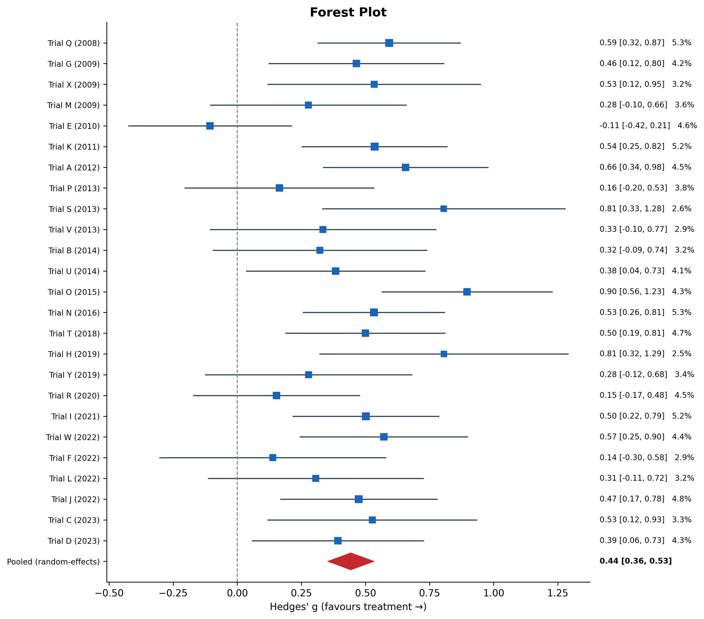
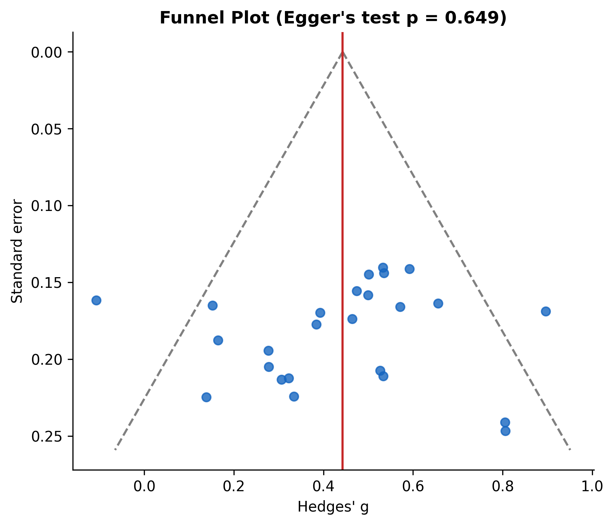

# Meta-Analysis Automation Kit

**Problem:** Doing a meta-analysis by hand is slow, and a small error in pooling or plots can cost a thesis chapter.

**What it does**
- PRISMA flow diagram
- Effect sizes (Hedges' g), fixed and random pooling
- Heterogeneity (Q, I², tau²) with automatic model choice
- Forest plot, funnel plot, Egger's test, leave-one-out check
- Auto-written results paragraph

**Data:** synthetic demo data. Replace it with your own study table.

**Run it:** open the notebook in Colab and click Runtime → Run all.

Author: Dr. Bejon Kumar Bhowmick
